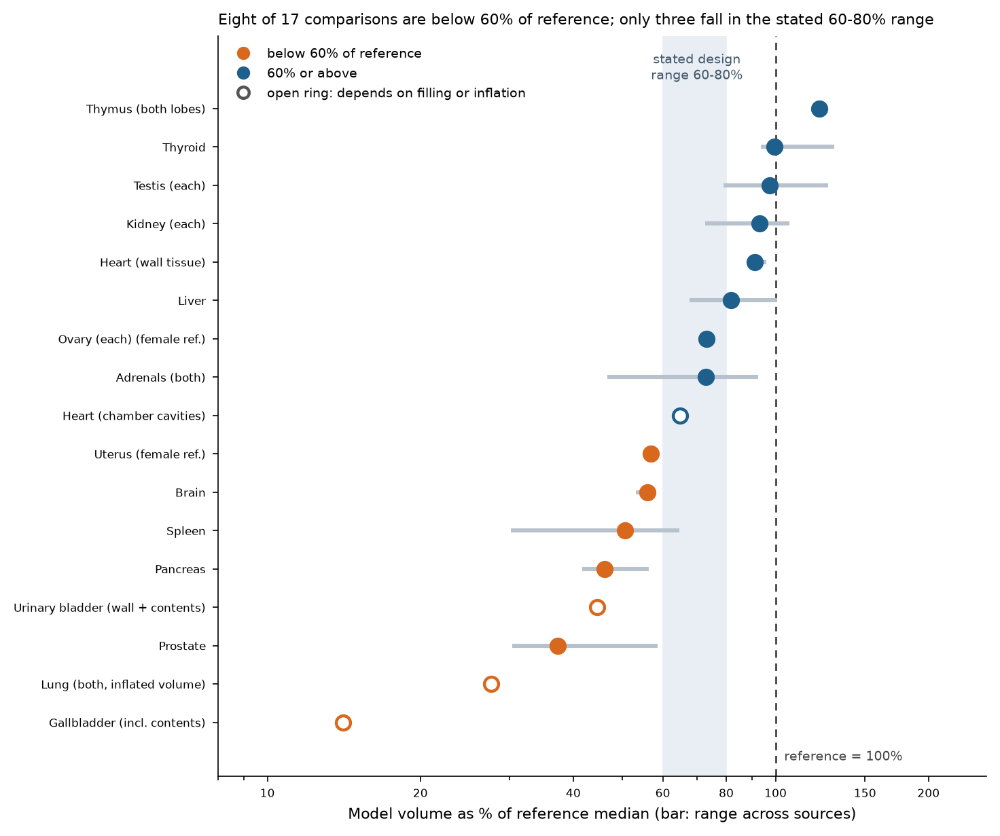

# Part 1: Reference organ size and mass for the 3D anatomy model

Project: 3D-Anatomy-Model (https://github.com/isaac070405/3D-Anatomy-Model, live demo https://isaac070405.github.io/3D-Anatomy-Model/). Date: 2026-11-25.

## 1. Summary

1. The model's organs are not uniformly 60-80% of textbook size, as the README states. Of 17 organ comparisons, 8 are below 60% of the reference median, 3 are in the 60-80% range, 5 are at 80-110% and 1 is above 110% ([figure](figures/model_vs_reference.png)).
2. Furthest below reference: gallbladder (14%), lungs (28%), prostate (37%), bladder (45%), pancreas (46%), spleen (50%), brain (56%) and uterus (57%). The gallbladder, lungs and bladder depend on filling or inflation, so they need a decision on which state to depict before any rescaling.
3. Close to reference: thyroid (99%), testis (97%), kidney (93%), heart wall tissue (91%) and liver (82% of the male median; 71% of the ICRP value).
4. Two internal inconsistencies stand out: the right adrenal gland is 1.2 mL against 5.0 mL on the left, and the left kidney is 14 mm longer than the right (131 vs 117 mm; autopsy difference is 2 mm).
5. Every reference value in the tables carries a source ID, citation (DOI or PMID) and a licence or copyright status. Values from paywalled papers are numbers only, taken from PubMed abstracts; no text is reproduced.

## 2. Methods

### 2.1 Model geometry
The page builds each organ in code (three.js 0.184.0, units in metres). I ran the repo's own geometry modules headlessly in Node ([extract_model_geometry.mjs](scripts/extract_model_geometry.mjs)), which produced 4,126 meshes, and measured each organ from the meshes:

- Closed meshes (liver, spleen, kidney, heart chambers, bladder, thymus, testis, uterus, ovary, gallbladder, adrenals, eyes): voxel union at 0.5-1 mm with a surface-offset correction calibrated on exact signed volumes (error of 1% or less against exact volumes on the spleen, kidney, thymus and gallbladder; overlap between parts removed, for example 91 mL of overlap between the three liver parts).
- Lungs: the six lobe surfaces share vertices and form one closed surface per side after stitching; volume is the exact signed volume.
- Open surfaces (pancreas, thyroid, prostate, brainstem tubes): mean of the signed volume and a voxel-fill estimate; flagged low confidence. The stomach is an open surface whose volume depends on the method (64-289 mL), so only its dimensions are reported.
- Brain: the MNI-template surfaces in assets/mni_brain.glb (the page loads these instead of the procedural cortex). The left cortex surface is open; I used twice the closed right-hemisphere volume (310.9 mL). The brainstem comes from procedural tubes.
- The two body skin meshes (Blender Studio base meshes) could not be loaded headlessly, so skin, fat, muscle and skeleton are not assessed in this part.

Result: [model_organ_geometry.csv](data/model_organ_geometry.csv) and [figure](figures/model_organ_volumes.png).

### 2.2 Literature and reference values
I searched PubMed for adult organ weights (autopsy) and organ volumes (CT, MRI, ultrasound), screened 46 records ([source_register.csv](data/source_register.csv)) and retrieved the open-access full texts of nine of them. I read the tables of four (Japanese nationwide CT, Geneva kidney autopsy, Chinese spleen CT, Dutch lobar lung CT); for all other papers, open or paywalled, I recorded only numbers visible in the PubMed abstract. ICRP Publication 89, 110, 133 and 145 values come from secondary pages seen through search snippets, because icrp.org and the other ICRP hosts are blocked in this environment; they are marked quality C and must be checked against the original before publication.

Quality grades in [organ_reference_values.csv](data/organ_reference_values.csv): A = number read from an open-access full-text table (sources S11, S14, S16, S26); B = number from a PubMed abstract; C = secondary transcription (ICRP); D = textbook-style web value with no primary measurement identified.

### 2.3 Harmonisation
Masses were converted to volume-equivalents so they could sit beside imaging volumes ([reference_estimates_volume_equivalent.csv](data/reference_estimates_volume_equivalent.csv)). Densities: liver 1.06 g/mL and brain 1.04 g/mL (ICRP 89 values seen in a secondary table), thyroid 1.051 and uterus 1.021 g/cm3 (ICRP 145 snippet); every other organ uses an assumed 1.05 g/mL, which was not sourced in this session. For each organ and sex I took the median of the source estimates as the reference and flagged organs where the highest and lowest estimates differ by more than 20% ([organ_reference_summary.csv](data/organ_reference_summary.csv), [figure](figures/reference_estimates_by_organ.png)).

The model is compared with male references (ICRP reference male 176 cm; the head top in the model code is at about 1.75 m) except uterus and ovary, which use female references.

## 3. Results

| Organ (reference sex) | Model (mL) | Reference median (mL) | Range across sources (mL) | Model as % of median | Linear scale to reach median | Class |
|---|---|---|---|---|---|---|
| Gallbladder (incl. contents) (M) | 9.3 | 66.0 | 66.0 to 66.0 | 14% | 1.92 (state-dependent) | far below reference (<60%) |
| Lung (both, inflated volume) (M) | 1695.8 | 6160.0 | 6120.0 to 6200.0 | 28% | 1.54 (state-dependent) | far below reference (<60%) |
| Prostate (M) | 9.5 | 25.5 | 16.2 to 31.3 | 37% | 1.39 | far below reference (<60%) |
| Urinary bladder (wall + contents) (M) | 107.2 | 240.4 | 240.4 to 240.4 | 45% | 1.31 (state-dependent) | far below reference (<60%) |
| Pancreas (M) | 35.9 | 77.9 | 63.7 to 86.2 | 46% | 1.29 | far below reference (<60%) |
| Spleen (M) | 63.4 | 125.6 | 98.1 to 210.4 | 50% | 1.26 | far below reference (<60%) |
| Brain (M) | 739.8 | 1320.2 | 1284.6 to 1394.2 | 56% | 1.21 | far below reference (<60%) |
| Uterus (F) | 44.5 | 78.4 | 78.4 to 78.4 | 57% | 1.21 | far below reference (<60%) |
| Heart (chamber cavities) (M) | 312.5 | 481.1 | 481.1 to 481.1 | 65% | 1.15 (state-dependent) | within stated 60-80% design range |
| Adrenals (both) (M) | 6.2 | 8.5 | 6.7 to 13.3 | 73% | 1.11 | within stated 60-80% design range |
| Ovary (each) (F) | 3.8 | 5.2 | 5.2 to 5.2 | 73% | 1.11 | within stated 60-80% design range |
| Liver (M) | 1202.0 | 1472.6 | 1194.7 to 1774.1 | 82% | 1.07 | near reference (80-110%) |
| Heart (wall tissue) (M) | 283.9 | 312.3 | 296.2 to 315.2 | 91% | 1.03 | near reference (80-110%) |
| Kidney (each) (M) | 132.0 | 142.1 | 123.8 to 181.4 | 93% | 1.02 | near reference (80-110%) |
| Testis (each) (M) | 13.2 | 13.6 | 10.4 to 16.7 | 97% | 1.01 | near reference (80-110%) |
| Thyroid (M) | 18.9 | 19.0 | 14.5 to 20.2 | 100% | 1.00 | near reference (80-110%) |
| Thymus (both lobes) (M) | 29.0 | 23.8 | 23.8 to 23.8 | 122% | 0.94 | above reference (>110%) |

Full table with ICRP percentages, mesh names and notes: [model_vs_reference.csv](data/model_vs_reference.csv). Linear dimensions: [model_vs_reference_dimensions.csv](data/model_vs_reference_dimensions.csv).

### 3.1 Notes by organ
- Reference sources disagree by more than 20% for liver (1.2-1.8 L), spleen (98-210 mL), kidney, pancreas, thyroid, adrenals, prostate and testis. The largest CT cohort is older routine-care patients (Japanese CT median age 67-71 y) while the autopsy series are young trauma deaths (18-35 y) and ICRP is a constructed reference, so the percentages above are a range, not a point.
- Heart: wall tissue matches reference (91%), but the four chamber cavities total 312 mL against about 481 mL of ICRP chamber blood (65%), so the heart looks thick-walled.
- Lungs: each lung starts as an ellipsoid of semi-axes 0.056, 0.118 and 0.088 m (2.4 L), which the rib-cage clipping and apex taper in the code reduce to 0.91 L (right) and 0.79 L (left). Inspiratory CT volumes are 6.1 L (men) and 4.7 L (women) in a Dutch cohort. A resting-volume reference was not found, so the 28% figure is against full inspiration.
- Brain: model volume 740 mL (about 770 g) against 1.29-1.39 L estimates (1,336-1,450 g). The cerebrum is 103 mm wide against a textbook 140 mm (quality D); height is 104 mm against 93 mm.
- Adrenals: the left gland (5.0 mL) is within the CT range; the right gland (1.2 mL) is 28-40% of the right-gland CT values (3.0 mL Japanese male median, 4.26 mL Chinese mean).
- Thymus: the model shows 29 mL; the ICRP adult reference is 25 g, and CT shows little solid thymic tissue after about 54 y.
- Not covered: stomach, intestines, eyes, skeleton, muscle, skin and fat. No verified reference was found for stomach or eye in this pass.

## 4. Recommendations for the model code

1. Rescale first the non-state-dependent organs below 60%: spleen (about x1.26 linear), pancreas (x1.29, low-confidence measurement), brain (x1.21; check skull clearance), prostate (x1.39) and uterus (x1.21). Linear factors are the cube root of reference-median over model volume; each change needs a visual check for overlap with neighbours, which is why the README says organs were reduced.
2. Decide which physiological state the page depicts for lungs, bladder, gallbladder and heart cavities, then set sizes from a state-matched reference.
3. Fix the asymmetries: enlarge the right adrenal to match the left, and shorten the left kidney to about 122 mm (Geneva male mean) so that it is close to the right.
4. Reduce the thymus by about 6% linear, or label it as a young-adult thymus.
5. Update the README sentence about "60 to 80% of textbook size" to say that sizes vary by organ, with this report as the reference.
6. Keep the liver, kidney, heart wall, thyroid, testis and ovary as they are.

## 5. Limitations

- Autopsy weights include blood and fluid; imaging volumes depend on contrast phase and segmentation; the Japanese CT used TotalSegmentator in a 3 mm fast mode.
- Several abstracts are truncated by PubMed or give only part of the data. Paywalled full texts (including the Molina and DiMaio series and the 2022 Archives of Pathology tables) were not read.
- Volumes of open surfaces (pancreas, thyroid, prostate, brainstem) are approximate; the two estimates for the pancreas span 33-39 mL, and the stomach could not be measured reliably.
- The 1.05 g/mL density is an assumption for organs other than liver, brain, thyroid and uterus.
- All populations are mixed; no single reference man is implied. ICRP values are secondary transcriptions.

## 6. Licence and citation register

How licences were established: open-access licence URLs were read from the PubMed Central XML (`ali:license_ref`) through NCBI E-utilities; for other papers the PubMed copyright record was checked and, where it names no open licence, the entry says so. A "no open licence found" entry means the paper is under the publisher's copyright; only numbers and the citation are used here. CC BY sources need attribution (the citation below); CC BY-NC sources (S22, S32) should not be copied into commercial products. The geometry measurements are derived from the project's own MIT-licensed code and from assets listed in THIRD_PARTY_NOTICES.md (MNI brain template under the ICBM 152 licence).

| ID | Source | Licence or copyright status | Quality of numbers taken |
|---|---|---|---|
| S01 | Molina DK et al. (2012) Normal organ weights in men: part I-the heart. Am J Forensic Med Pathol 33(4):362-7 doi:10.1097/PAF.0b013e31823d298b | Publisher copyright; no open licence found in PubMed/PMC record | B |
| S02 | Molina DK et al. (2012) Normal organ weights in men: part II-the brain, lungs, liver, spleen, and kidneys. Am J Forensic Med Pathol 33(4):368-72 doi:10.1097/PAF.0b013e31823d29ad | Publisher copyright; no open licence found in PubMed/PMC record | B |
| S03 | Molina DK et al. (2015) Normal Organ Weights in Women: Part I-The Heart. Am J Forensic Med Pathol 36(3):176-81 doi:10.1097/PAF.0000000000000174 | Publisher copyright; no open licence found in PubMed/PMC record | B |
| S04 | Molina DK et al. (2015) Normal Organ Weights in Women: Part II-The Brain, Lungs, Liver, Spleen, and Kidneys. Am J Forensic Med Pathol 36(3):182-7 doi:10.1097/PAF.0000000000000175 | Publisher copyright; no open licence found in PubMed/PMC record | B |
| S08 | Yang T et al. (2024) A statistical study of postmortem heart weight in Chinese adults. Forensic Sci Int 354:111912 doi:10.1016/j.forsciint.2023.111912 | Publisher copyright (Copyright © 2023 Elsevier B.V. All rights reserved.); no open licence found in PubMed/PMC record | B |
| S09 | Chirachariyavej T et al. (2006) Normal internal organ weight of Thai adults correlated to body length and body weight. J Med Assoc Thai 89(10):1702-12 | Publisher copyright; no open licence found in PubMed/PMC record | B |
| S10 | Hartmann P et al. (1994) [Normal weight of the brain in adults in relation to age, sex, body height and weight]. Pathologe 15(3):165-70 doi:10.1007/s002920050040 | Publisher copyright; no open licence found in PubMed/PMC record | B |
| S11 | Kalucki SA et al. (2020) Reference values and sex differences in absolute and relative kidney size. A Swiss autopsy study. BMC Nephrol 21(1):289 doi:10.1186/s12882-020-01946-y | CC BY 4.0 | A |
| S13 | ICRP (2002) Basic anatomical and physiological data for use in radiological protection: reference values. Publication 89. Ann ICRP 32(3-4) | ICRP publication; (c) ICRP; values quoted from secondary pages | C |
| S14 | Kikuchi T et al. (2026) Nationwide organ volume distributions and cross-sectional age-associated differences in abdominal CT from Japan. Jpn J Radiol 44(10):1810-1817 doi:10.1007/s11604-026-02028-z | CC BY 4.0 | A |
| S15 | Reschke P et al. (2026) Age- and sex-specific CT reference trajectories for abdominal organ volumes and attenuation: a large-scale automated analysis. Eur J Radiol 205:113247 doi:10.1016/j.ejrad.2026.113247 | Publisher copyright (Copyright © 2026. Published by Elsevier B.V.); no open licence found in PubMed/PMC record | B |
| S16 | Tan T et al. (2026) Deep-Learning-based Automatic Segmentation and Quantitative Measurement of Normal Spleen in Chinese Adults. Curr Med Imaging 22:e15734056472787 doi:10.2174/0115734056472787260516112449 | CC BY 4.0 | A |
| S18 | Kaneko J et al. (2002) Normal splenic volume in adults by computed tomography. Hepatogastroenterology 49(48):1726-7 | Publisher copyright; no open licence found in PubMed/PMC record | B |
| S19 | Kipp JP et al. (2019) Normal pancreatic volume in adults is influenced by visceral fat, vertebral body width and age. Abdom Radiol (NY) 44(3):958-966 doi:10.1007/s00261-018-1793-8 | Publisher copyright; no open licence found in PubMed/PMC record | B |
| S20 | Djuric-Stefanovic A et al. (2012) CT volumetry of normal pancreas: correlation with the pancreatic diameters measurable by the cross-sectional imaging, and relationship with the gender, age, and body constitution. Surg Radiol Anat 34(9):811-7 doi:10.1007/s00276-012-0962-7 | Publisher copyright; no open licence found in PubMed/PMC record | B |
| S21 | Cai J et al. (2022) Automatic quantitative evaluation of normal pancreas based on deep learning in a Chinese adult population. Abdom Radiol (NY) 47(3):1082-1090 doi:10.1007/s00261-021-03327-x | Publisher copyright (© 2022. The Author(s), under exclusive licence to Springer Science+Business Media, LLC, part of Springer Nature.); no open licence found in PubMed/PMC record | B |
| S22 | Feng LM et al. (2017) New formula for predicting standard liver volume in Chinese adults. World J Gastroenterol 23(27):4968-4977 doi:10.3748/wjg.v23.i27.4968 | CC BY-NC 4.0 | B |
| S23 | Şahin E et al. (2015) Regional reference values of thyroid gland volume in Turkish Adults. Srp Arh Celok Lek 143(3-4):141-5 doi:10.2298/sarh1504141s | Publisher copyright; no open licence found in PubMed/PMC record | B |
| S24 | Guo W et al. (2021) New Reference Values for Thyroid Volume and a Comprehensive Assessment for Influencing Factors in Chinese Adults with Iodine Sufficiency. Eur Thyroid J 10(6):447-454 doi:10.1159/000513494 | Publisher copyright (Copyright © 2021 by European Thyroid Association Published by S. Karger AG, Basel.); no open licence found in PubMed/PMC record | B |
| S25 | Wisselink HJ et al. (2023) Predicted versus CT-derived total lung volume in a general population: The ImaLife study. PLoS One 18(6):e0287383 doi:10.1371/journal.pone.0287383 | CC BY 4.0 | B |
| S26 | Bakker JT et al. (2025) Reference formulas for chest CT-derived lobar volumes in the lung-healthy general population. Eur Radiol 35(5):2912-2921 doi:10.1007/s00330-024-11123-6 | CC BY 4.0 | A |
| S27 | Wu F et al. (2021) Total Lung and Lobar Quantitative Assessment Based on Paired Inspiratory-Expiratory Chest CT in Healthy Adults: Correlation with Pulmonary Ventilatory Function. Diagnostics (Basel) 11(10): doi:10.3390/diagnostics11101791 | CC BY 4.0 | B |
| S30 | Lindholz M et al. (2026) Reference values for PSA, PSA density, and MRI prostate volume in healthy German men. Eur Radiol : doi:10.1007/s00330-026-12937-2 | © The Author(s) 2026 (Eur Radiol); specific licence type not retrieved | B |
| S31 | Mathis J et al. (2022) Normative values of the internal genital organs of the female pelvis in transvaginal and transabdominal ultrasound. Med Ultrason 24(3):290-299 doi:10.11152/mu-3584 | Publisher copyright; no open licence found in PubMed/PMC record | B |
| S32 | Osman KA et al. (2026) Normal Reference Values for Testicular Volume in Adult Somali Men: A Retrospective Study. Res Rep Urol 18:615746 doi:10.2147/RRU.S615746 | CC BY-NC 4.0 | B |
| S33 | Wang X et al. (2013) Evaluation of Normal Adrenal Gland Volume by 64-slice CT. Chin Med Sci J 27(4):220-4 doi:10.1016/s1001-9294(13)60005-x | Publisher copyright; no open licence found in PubMed/PMC record | B |
| S35 | Nevsky G et al. (2011) Sex-specific normalized reference values of heart and great vessel dimensions in cardiac CT angiography. AJR Am J Roentgenol 196(4):788-94 doi:10.2214/AJR.10.4990 | Publisher copyright; no open licence found in PubMed/PMC record | B |
| S47 | ICRP (2009) Adult reference computational phantoms. ICRP Publication 110. Ann ICRP 39(2) doi:10.1016/j.icrp.2009.09.001 | ICRP publication; (c) ICRP/Elsevier; values transcribed from a secondary hosted copy seen via search (https://psec.uchicago.edu/Simulation/ICRP_P110.pdf); verify against the original before publishing | C |
| S48 | Bolch WE et al. (2016) ICRP Publication 133: The ICRP computational framework for internal dose assessment for reference adults: specific absorbed fractions. Ann ICRP 45(2 Suppl) doi:10.1177/0146645316661077 | ICRP publication; (c) ICRP/SAGE; Annex A masses seen in search snippet | C |
| S49 | Kim CH et al. (2020) ICRP Publication 145: Adult mesh-type reference computational phantoms. Ann ICRP 49(3) doi:10.1177/0146645319893605 | ICRP publication; (c) ICRP/SAGE; snippet only | C |
| S50 | ICRP Task Group 103 draft report for consultation (2018) Adult mesh-type reference computational phantoms (https://www.icrp.org/docs/TG103%20Report%20for%20Consultation%2020180906.pdf) | ICRP draft; (c) ICRP; snippet only | C |
| S51 | Improved accuracy of S-value-based dosimetry: a guide to transition from Cristy-Eckerman to ICRP adult phantoms (PMC9418401) PMC9418401 | PMC article; licence not checked | C |
| S52 | Chudler E. Brain Facts and Figures, University of Washington (https://faculty.washington.edu/chudler/facts.html); The Physics Factbook, Mass of a Human Brain (https://hypertextbook.com/facts/2003/RachelScottRosenbluth.shtml) | Web pages; licence not stated in the search snippet | D |

Full register with excluded sources and reasons: [source_register.csv](data/source_register.csv).
